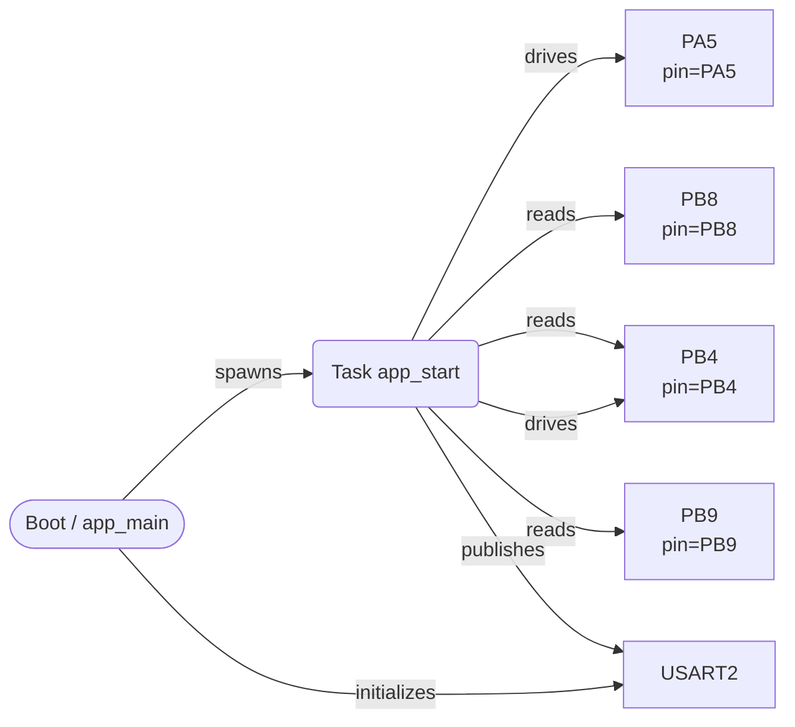
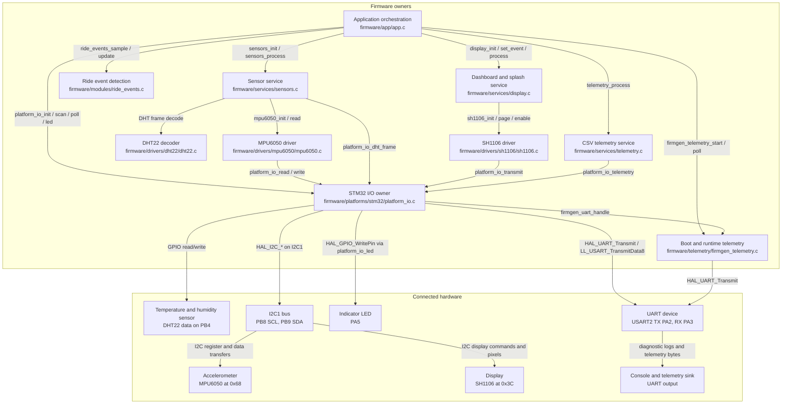
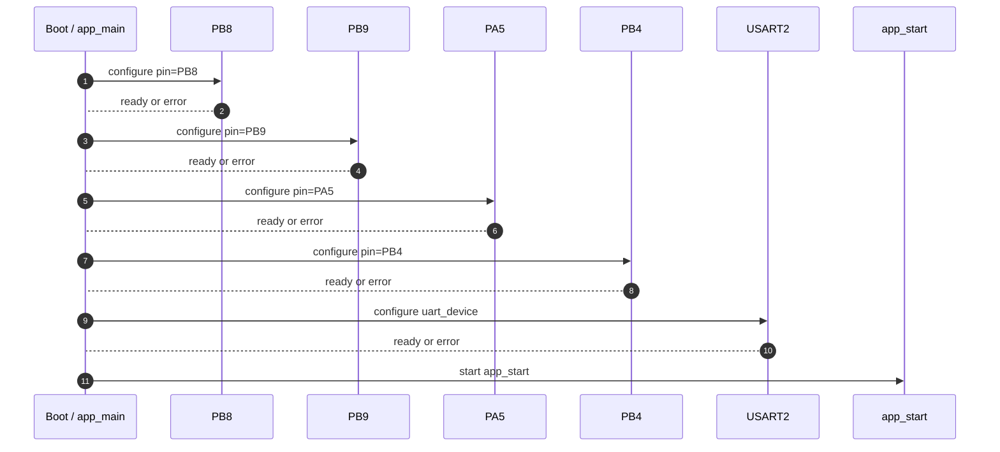
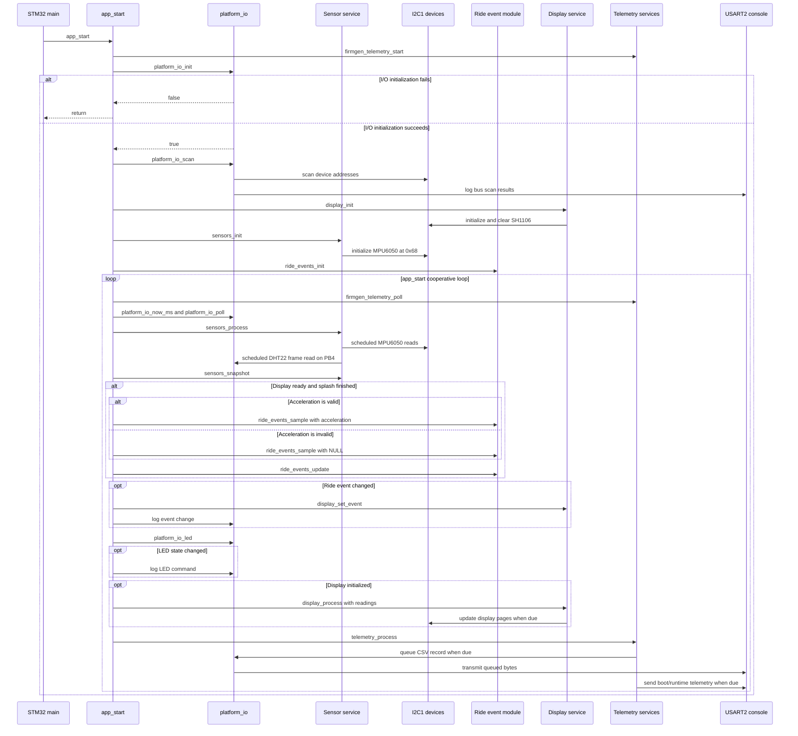
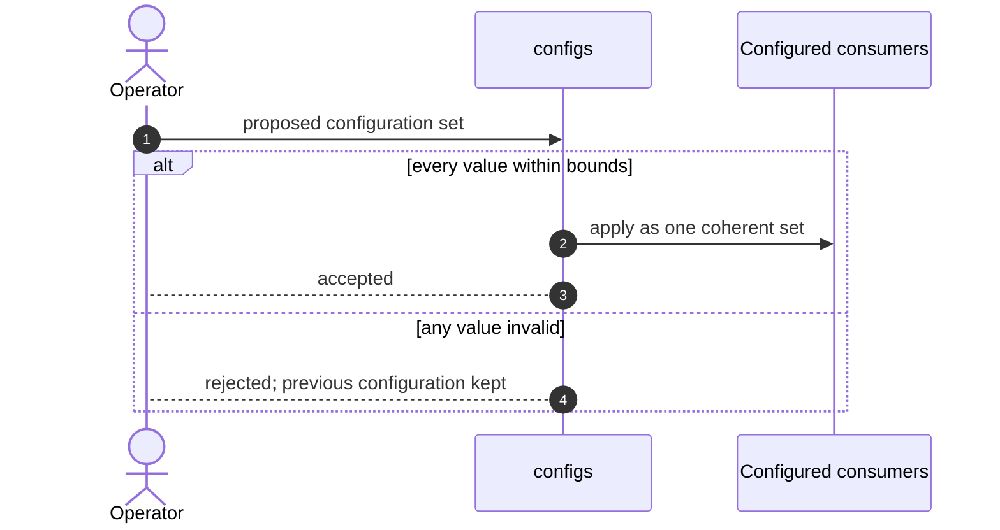

# Firmware Design Specification — vehicleparametersdisplay

> **Document status:** complete, all checks passed.

| Field | Value |
| --- | --- |
| Document ID | FDS-VEHICLEPARAMETERSDISPLAY-001 |
| Project | vehicleparametersdisplay |
| PIR revision | 7c96595f4e37ab78823acf279831f536 |
| Board | not recorded |
| Target | not recorded |
| Generated | 2026-11-16 14:28 UTC |
| Analysed files | 45 |
| Diagrams reviewed | not yet |
| Requirements workbook | the frozen specification |
| Status | Generated from the as-built project |

> Generation rule: unresolved implementation details are surfaced as editable parameters or design decisions. They are not silently converted into fixed product behavior.

## 1. Purpose and Scope

### 1.1 Source Basis

| Source | Use in this specification |
| --- | --- |
| Analysed project sources (45 files) | Primary input. Every module, task flow, pin binding and partition in this document is read from these files. |
| PIR revision 7c96595f4e37ab78823acf279831f536 | The exact analysis this document describes. Regenerating after a source change produces a different revision. |

### 1.2 Modelling Basis

The structure of this document follows the information content of an IEEE 1016 software design description and the viewpoint structure of ISO/IEC/IEEE 42010. Interaction diagrams use UML sequence notation. The structure is a reference template; it does not claim certification to those standards.

### 1.4 Analysed Source Inventory

| File | Module | Module kind | Facts read from this file |
| --- | --- | --- | --- |
| CMakeLists.txt | — | — | read; no facts cited from it |
| Core/Inc/main.h | Core/Inc | module | read; no facts cited from it |
| Core/Inc/stm32g0xx_hal_conf.h | Core/Inc | module | read; no facts cited from it |
| Core/Inc/stm32g0xx_it.h | Core/Inc | module | read; no facts cited from it |
| Core/Src/main.c | Core/Src | module | 1 topology element(s); 2 include dependency(ies) |
| Core/Src/stm32g0xx_hal_msp.c | Core/Src | module | read; no facts cited from it |
| Core/Src/stm32g0xx_it.c | Core/Src | module | read; no facts cited from it |
| Core/Src/system_stm32g0xx.c | Core/Src | module | read; no facts cited from it |
| Core/Startup/iar/firmgen_iar_syscalls.c | Core/Startup/iar | module | read; no facts cited from it |
| firmware/app/app.c | app | application | 1 topology element(s); 5 include dependency(ies); 37 control-flow step(s) |
| firmware/app/app.h | app | application | read; no facts cited from it |
| firmware/bsp/board.c | bsp | board | read; no facts cited from it |
| firmware/bsp/board.h | bsp | board | 1 include dependency(ies) |
| firmware/configs/app_config.h | configs | configuration | read; no facts cited from it |
| firmware/configs/build_config.h | configs | configuration | read; no facts cited from it |
| firmware/configs/config.h | configs | configuration | read; no facts cited from it |
| firmware/configs/feature_config.h | configs | configuration | read; no facts cited from it |
| firmware/configs/platform_config.h | configs | configuration | read; no facts cited from it |
| firmware/drivers/dht22/dht22.c | drivers/dht22 | driver | read; no facts cited from it |
| firmware/drivers/dht22/dht22.h | drivers/dht22 | driver | read; no facts cited from it |
| firmware/drivers/mpu6050/mpu6050.c | drivers/mpu6050 | driver | read; no facts cited from it |
| firmware/drivers/mpu6050/mpu6050.h | drivers/mpu6050 | driver | read; no facts cited from it |
| firmware/drivers/sh1106/sh1106.c | drivers/sh1106 | driver | read; no facts cited from it |
| firmware/drivers/sh1106/sh1106.h | drivers/sh1106 | driver | read; no facts cited from it |
| firmware/interfaces/platform_io.h | interfaces | module | read; no facts cited from it |
| firmware/modules/ride_events.c | modules | module | 1 include dependency(ies) |
| firmware/modules/ride_events.h | modules | module | read; no facts cited from it |
| firmware/osal/osal.h | osal | abstraction | read; no facts cited from it |
| firmware/platforms/stm32/osal_baremetal.c | platforms/stm32 | platform | 1 include dependency(ies) |
| firmware/platforms/stm32/platform_io.c | platforms/stm32 | platform | 5 topology element(s); 3 include dependency(ies) |
| firmware/services/display.c | services | module | 3 include dependency(ies) |
| firmware/services/display.h | services | module | read; no facts cited from it |
| firmware/services/display_font.h | services | module | read; no facts cited from it |
| firmware/services/logo.h | services | module | read; no facts cited from it |
| firmware/services/sensors.c | services | module | 1 include dependency(ies) |
| firmware/services/sensors.h | services | module | 1 include dependency(ies) |
| firmware/services/telemetry.c | services | module | read; no facts cited from it |
| firmware/services/telemetry.h | services | module | 1 include dependency(ies) |
| firmware/telemetry/fg_telemetry_profile.h | telemetry | module | read; no facts cited from it |
| firmware/telemetry/firmgen_telemetry.c | telemetry | module | read; no facts cited from it |
| firmware/telemetry/firmgen_telemetry.h | telemetry | module | read; no facts cited from it |
| firmware/utils/helpers/helpers.c | utils/helpers | utility | read; no facts cited from it |
| firmware/utils/helpers/helpers.h | utils/helpers | utility | read; no facts cited from it |
| firmware/utils/logger/logger.c | utils/logger | utility | read; no facts cited from it |
| firmware/utils/logger/logger.h | utils/logger | utility | read; no facts cited from it |

## 2. System Context and Wiring Topology

> The diagrams in this document have not been marked reviewed in the Firmware Topology panel. They describe the analysed project as it stands; review them there before treating this document as approved.

**Figure 1.** Wiring and external connectivity topology.

### 2.1 Wiring Control Table

| Connection | Baseline | Editability | Verification |
| --- | --- | --- | --- |
| PB8 | PB8 | Platform — regenerated from the board configuration | Pin is input-capable at the expected level. |
| PB9 | PB9 | Platform — regenerated from the board configuration | Pin is input-capable at the expected level. |
| PA5 | PA5 | Platform — regenerated from the board configuration | Pin exists on the target and is drive-capable. |
| PB4 | PB4 | Platform — regenerated from the board configuration | Pin exists on the target and is drive-capable. |

### 2.2 Dynamic Design Parameters

| Parameter group | Resolved baseline | Still requires decision |
| --- | --- | --- |
| Peripherals | 5 peripheral(s): PB8, PB9, PA5, PB4, USART2; buses: uart |  |
| Runtime | 1 task(s): app_start (aperiodic) |  |

### 2.3 Peripheral and Interface Configuration

| Element | Type | Configured values | Source |
| --- | --- | --- | --- |
| Boot / app_main | system_init | target = stm32 | Core/Src/main.c |
| PA5 | gpio_output | pin = PA5 | firmware/platforms/stm32/platform_io.c |
| PB4 | gpio_output | pin = PB4 | firmware/platforms/stm32/platform_io.c |
| PB8 | gpio_input | pin = PB8 | firmware/platforms/stm32/platform_io.c |
| PB9 | gpio_input | pin = PB9 | firmware/platforms/stm32/platform_io.c |
| Task app_start | timer | period_ms = 0.0; task_name = app_start | firmware/app/app.c |
| USART2 | uart_device | baud_rate = 115200; port = 1 | firmware/platforms/stm32/platform_io.c |

## 3. High-Level Design (HLD)

**Figure 2.** High-level layered firmware architecture and dependency direction.

### 3.1 Architectural Layers

| Layer | Source modules | Runtime and hardware elements |
| --- | --- | --- |
| Application | app | Task app_start |
| Platform and drivers | bsp, drivers/dht22, drivers/mpu6050, drivers/sh1106, osal, platforms/stm32 | PA5, PB4, PB8, PB9, USART2 |
| Configuration and support | configs, utils/helpers, utils/logger | Boot / app_main |

### 3.2 Runtime Task Model

| Task | Nominal trigger | Owns / calls | Blocking policy |
| --- | --- | --- | --- |
| app_start (app_start) | Event driven; no period established | platform_io_log(event == RIDE_NONE ? "EVENT cleared\r\n…), platform_io_log(ride_events_message(event)), platform_io_log("\r\n"), platform_io_log(led_on ? "LED command ON\r\n" : "LED co…) | Decision Required — priority and stack size are not established by static analysis |

## 4. Low-Level Design (LLD)

**Figure 3.** Low-level module contracts and runtime control flow.

```mermaid
flowchart TD
  subgraph AppStart["app_start main-context loop"]
    start["Start telemetry and initialize application state<br/>firmware/app/app.c:14"]
    init{"platform_io_init succeeds — firmware/app/app.c:21"}
    failed["Return from app_start<br/>firmware/app/app.c:22"]
    setup["Scan bus#59; initialize display, sensors, and ride events<br/>firmware/app/app.c:25-27"]
    poll["Poll telemetry and platform I/O#59; read current time<br/>firmware/app/app.c:29-32"]
    process["Process sensor schedules and get snapshot<br/>firmware/app/app.c:37-39"]
    display_gate{"Display ready and splash finished — firmware/app/app.c:42"}
    accel_gate{"Acceleration reading valid — firmware/app/app.c:44"}
    sample["Submit acceleration sample or invalid sample<br/>firmware/app/app.c:46-56"]
    update["Update ride event and LED state<br/>firmware/app/app.c:58"]
    event_gate{"Event changed — firmware/app/app.c:59"}
    event_output["Update display event text and log event<br/>firmware/app/app.c:61-69"]
    led["Apply LED state<br/>firmware/app/app.c:71"]
    led_gate{"LED state changed — firmware/app/app.c:72"}
    led_log["Log LED command<br/>firmware/app/app.c:74-78"]
    display_ready{"Display initialized — firmware/app/app.c:80"}
    render["Process display state and dashboard pages<br/>firmware/app/app.c:82"]
    telemetry["Process periodic CSV telemetry<br/>firmware/app/app.c:84"]
  end

  start --> init
  init -->|no| failed
  init -->|yes| setup
  setup --> poll
  poll --> process
  process --> display_gate
  display_gate -->|yes| accel_gate
  display_gate -->|no| event_gate
  accel_gate -->|yes| sample
  accel_gate -->|no| sample
  sample --> update
  update --> event_gate
  event_gate -->|yes| event_output
  event_gate -->|no| led
  event_output --> led
  led --> led_gate
  led_gate -->|yes| led_log
  led_gate -->|no| display_ready
  led_log --> display_ready
  display_ready -->|yes| render
  display_ready -->|no| telemetry
  render --> telemetry
  telemetry -->|next loop| poll
```

**Figure 4.** Peripheral service state machine for initialisation, fault containment and controlled recovery.

*Not drawn — a fault and recovery state machine needs an analysed task flow carrying both a decision step and an error step. No task flow in this project has both.*

### 4.1 Module Contracts

| Module | Kind | Files | Depends on | Trace |
| --- | --- | --- | --- | --- |
| Core/Inc | module | 3 | — | Core/Inc |
| Core/Src | module | 4 | Core_Inc, app | Core/Src/main.c:21 |
| Core/Startup/iar | module | 1 | — | Core/Startup/iar |
| app | application | 2 | configs, interfaces, modules, services, telemetry | firmware/app/app.c:8 |
| bsp | board | 2 | configs | firmware/bsp/board.h:19 |
| configs | configuration | 5 | — | configs |
| drivers/dht22 | driver | 2 | — | drivers/dht22 |
| drivers/mpu6050 | driver | 2 | — | drivers/mpu6050 |
| drivers/sh1106 | driver | 2 | — | drivers/sh1106 |
| interfaces | module | 1 | — | interfaces |
| modules | module | 2 | configs | firmware/modules/ride_events.c:3 |
| osal | abstraction | 1 | — | osal |
| platforms/stm32 | platform | 2 | bsp, configs, interfaces, osal | firmware/platforms/stm32/platform_io.c:4 |
| services | module | 8 | configs, drivers_dht22, drivers_mpu6050, drivers_sh1106, interfaces, modules | firmware/services/display.c:5 |
| telemetry | module | 3 | — | telemetry |
| utils/helpers | utility | 2 | — | utils/helpers |
| utils/logger | utility | 2 | — | utils/logger |

### 4.3 Failure Handling

| Condition | Handling | Trace |
| --- | --- | --- |
| (!platform_io_init()) | Branches the cycle of app_start. | firmware/app/app.c:20 |
| (is_display_ready && !display_is_splash… | Branches the cycle of app_start. | firmware/app/app.c:38 |
| (readings->acceleration_valid) | Branches the cycle of app_start. | firmware/app/app.c:40 |
| (event != previous_event) | Branches the cycle of app_start. | firmware/app/app.c:53 |
| (event != RIDE_NONE) | Branches the cycle of app_start. | firmware/app/app.c:57 |
| (led_on != previous_led) | Branches the cycle of app_start. | firmware/app/app.c:65 |
| (is_display_ready) | Branches the cycle of app_start. | firmware/app/app.c:70 |

### 4.4 Include Dependencies

| From | To | Via | Symbol | Trace |
| --- | --- | --- | --- | --- |
| Core/Src | Core/Inc | include | main.h | Core/Src/main.c:21 |
| Core/Src | app | include | app.h | Core/Src/main.c:22 |
| app | configs | include | app_config.h | firmware/app/app.c:8 |
| app | interfaces | include | platform_io.h | firmware/app/app.c:3 |
| app | modules | include | ride_events.h | firmware/app/app.c:6 |
| app | services | include | sensors.h | firmware/app/app.c:4 |
| app | telemetry | include | firmgen_telemetry.h | firmware/app/app.c:10 |
| bsp | configs | include | app_config.h | firmware/bsp/board.h:19 |
| modules | configs | include | config.h | firmware/modules/ride_events.c:3 |
| platforms/stm32 | bsp | include | board.h | firmware/platforms/stm32/platform_io.c:4 |
| platforms/stm32 | configs | include | app_config.h | firmware/platforms/stm32/platform_io.c:3 |
| platforms/stm32 | interfaces | include | platform_io.h | firmware/platforms/stm32/platform_io.c:2 |
| platforms/stm32 | osal | include | osal.h | firmware/platforms/stm32/osal_baremetal.c:20 |
| services | configs | include | config.h | firmware/services/display.c:5 |
| services | drivers/dht22 | include | dht22.h | firmware/services/sensors.c:3 |
| services | drivers/mpu6050 | include | mpu6050.h | firmware/services/sensors.h:6 |
| services | drivers/sh1106 | include | sh1106.h | firmware/services/display.c:3 |
| services | interfaces | include | platform_io.h | firmware/services/display.c:4 |
| services | modules | include | ride_events.h | firmware/services/telemetry.h:6 |

## 5. Sequence Diagrams

**Figure 5.** Startup and initialisation sequence.

**Figure 6.** Normal acquisition, processing and output sequence.

**Figure 7.** Fault detection and controlled recovery sequence.

*Not drawn — a fault recovery sequence needs both a task flow with an error path and a diagnostics or logging sink to report it to. This project does not have both.*

**Figure 8.** Validated and atomic configuration update sequence.

**Figure 9.** Secure firmware download, verification, staging and activation sequence.

*Not drawn — no firmware update surface was found: no OTA or update node, and no OTA partition.*

## 6. Security and Update Design

### 6.1 Security and Update Surface

| Surface | Found in the analysed project | Consequence for this design |
| --- | --- | --- |
| Update slot | No OTA partition among the 0 declared | The image can only be replaced over the wire by re-flashing. |
| Update service | No OTA or update element in the topology | Figure 9 is not drawn; there is no update flow to verify. |
| Secure boot and flash encryption | Not visible to static source analysis | Confirm against the build configuration; this document cannot establish either. |

## 7. Timing and Resource Budget

| Budget item | Requirement / baseline | Design status | Closure evidence |
| --- | --- | --- | --- |
| Task priorities and stack sizes | Not established by static analysis | Decision Required | Scheduler configuration review plus stack high-water measurement. |
| Flash, RAM and CPU headroom | Not established by static analysis | Decision Required | Map file plus runtime resource measurement. |

## 8. Design Decision Register

> The analyser recorded no unresolved parameter at this revision, so there is no open decision to register here. Every parameter group in section 2.2 resolved to a baseline, and the items section 7 marks as requiring a decision are measurements rather than design choices.

## 9. Requirement-to-Design Traceability

> Traced from the frozen specification: 33 of 33 requirements reach an element of the analysed                          design, through the files recorded against them or by naming it;                          0 do not and are listed as not yet traced.

| Req ID | Source Type | Category | Requirement | Design element | Verification |
| --- | --- | --- | --- | --- | --- |
| HW-001 | — | Board & Firmware Configuration | The firmware shall target the STM32-NUCLEO-G070RB development board. | bsp module | hardware / instrument (implemented, untested) |
| HW-003 | — | Board & Firmware Configuration | The firmware project shall provide a configurable LOGO_DISPLAY_MS macro in config.h with a default value of 2000. | configs module | inspection (implemented, untested) |
| HW-004 | — | Board & Firmware Configuration | The firmware project shall define the climate and ride-event thresholds, sudden window, and event display time as configurable parameters in config.h. | configs module | inspection (implemented, untested) |
| FR-019 | — | Board & Firmware Configuration | The firmware shall use 32 degC as the configured high-temperature threshold. | configs module | inspection (implemented, untested) |
| FR-020 | — | Board & Firmware Configuration | The firmware shall use 75% as the configured high-humidity threshold. | configs module | inspection (implemented, untested) |
| IF-001 | — | Sensor Acquisition & I2C Bus | The firmware shall acquire temperature and humidity from a DHT22 sensor connected through PB4. | configs module, drivers/dht22 module, platforms/stm32 module, services module | hardware / instrument (implemented, untested) |
| IF-002 | — | Sensor Acquisition & I2C Bus | The firmware shall interface with an MPU6050 3-axis accelerometer and gyroscope over I2C on PB8 (SCL) and PB9 (SDA), sharing the bus with the OLED. | configs module, interfaces module, platforms/stm32 module | inspection (implemented, untested) |
| IF-007 | — | Sensor Acquisition & I2C Bus | The firmware shall coordinate access to the shared I2C bus so transactions to the MPU6050 and OLED do not overlap or corrupt one another. | configs module, interfaces module, platforms/stm32 module | host test (implemented, untested) |
| FR-002 | — | Sensor Acquisition & I2C Bus | While displaying the logo, the firmware shall initialize the DHT22 and perform MPU6050 zeroing in the background without extending the splash duration. | app module, services module | host test (implemented, untested) |
| FR-005 | — | Sensor Acquisition & I2C Bus | The firmware shall read temperature in degrees Celsius and humidity in percent from the DHT22 every 2 seconds. | configs module, drivers/dht22 module, platforms/stm32 module, services module | host test (implemented, untested) |
| FR-007 | — | Sensor Acquisition & I2C Bus | The firmware shall read the MPU6050 X, Y, and Z acceleration at 100 Hz using the +/-4 g range and convert the readings to g units. | app module, drivers/mpu6050 module, services module | host test (implemented, untested) |
| FR-008 | — | Sensor Acquisition & I2C Bus | At power-up, the firmware shall zero the MPU6050 readings after the board has been flat and still for 1 second, producing X = 0 g, Y = 0 g, and Z = 1 g. | app module, drivers/mpu6050 module, services module | host test (implemented, untested) |
| FR-009 | — | Sensor Acquisition & I2C Bus | The firmware shall map X acceleration to lateral cornering, Y acceleration to longitudinal acceleration/braking, and Z acceleration to vertical bumps. | app module, drivers/mpu6050 module, services module | host test (implemented, untested) |
| DIAG-001 | — | Sensor Acquisition & I2C Bus | The firmware shall detect failed DHT22 or MPU6050 acquisitions and shall not use failed acquisition results as valid displayed measurements or inputs to event detection. | app module, drivers/mpu6050 module, services module | host test (implemented, untested) |
| IF-003 | — | OLED Display & Startup UI | The firmware shall drive a 1.3-inch I2C OLED using the SH1106 driver over PB8 (SCL) and PB9 (SDA), shared with the MPU6050. | drivers/sh1106 module, platforms/stm32 module, services module | inspection (implemented, untested) |
| HW-002 | — | OLED Display & Startup UI | The firmware project shall contain the CraftifAI logo as a flash-resident 1-bit monochrome bitmap array in logo.h, formatted for the SH1106 as 128x64 pixels, 8 pages by 128 columns, with LSB as the top row. | services module | inspection (implemented, untested) |
| FR-001 | — | OLED Display & Startup UI | The firmware shall display the 124x26-pixel logo artwork centred on the display with a black border, white on a black background. | services module | inspection (implemented, untested) |
| FR-003 | — | OLED Display & Startup UI | The firmware shall implement splash timing non-blockingly using HAL_GetTick rather than a blocking delay. | app module, platforms/stm32 module, services module | inspection (implemented, untested) |
| FR-004 | — | OLED Display & Startup UI | During the logo splash, the firmware shall show no alerts and shall not blink the LED. | app module, platforms/stm32 module, services module | host test (implemented, untested) |
| IF-004 | — | OLED Display & Startup UI | The SH1106 driver shall apply a 2-column offset when writing the logo and all other screens to account for its 132 columns of RAM and 128 visible columns. | drivers/sh1106 module, platforms/stm32 module, services module | host test (implemented, untested) |
| FR-012 | — | OLED Display & Startup UI | When an event occurs, the firmware shall immediately show its message on the OLED while keeping Temperature and Humidity visible. | services module | host test (implemented, untested) |
| FR-016 | — | OLED Display & Startup UI | After the splash, the firmware shall display a Vehicle Parameters screen containing temperature from the DHT22 in degC, humidity from the DHT22 in percent, and X, Y, and Z acceleration values in g. | services module | host test (implemented, untested) |
| IF-006 | — | OLED Display & Startup UI | The firmware shall initialize the SH1106 display interface before its first display write, early enough for the logo to appear within 100 ms of power-up. | app module, platforms/stm32 module, services module | hardware / instrument (implemented, untested) |
| FR-018 | — | OLED Display & Startup UI | On power-up or reset, the firmware shall display the CraftifAI logo on the OLED for 2 seconds before displaying sensor data or a heading, then switch to the Vehicle Parameters screen. | app module, platforms/stm32 module, services module | hardware / instrument (implemented, untested) |
| FR-021 | — | OLED Display & Startup UI | The firmware shall display the acceleration values on the Vehicle Parameters screen using the labels "X:", "Y:", and "Z:", with the Z value followed by " g". | services module | host test (implemented, untested) |
| FR-006 | — | Ride Event Detection & LED Alerts | When temperature or humidity exceeds its configured high limit, the firmware shall display an exclamation mark next to the corresponding value. | configs module, services module | hardware / instrument (implemented, untested) |
| FR-010 | — | Ride Event Detection & LED Alerts | The firmware shall detect an event when its associated axis changes by at least the configured threshold within 100 ms. | app module, configs module, modules module | host test (implemented, untested) |
| FR-011 | — | Ride Event Detection & LED Alerts | The firmware shall detect and identify Unseen SpeedBreaker when Z changes by at least 0.30 g, Wide Turn when X changes by at least 0.25 g, Speeding when Y changes positively by at least 0.25 g, and Sudden Braking when Y changes negatively by at least 0.25 g. | app module, configs module, modules module | host test (implemented, untested) |
| IF-005 | — | Ride Event Detection & LED Alerts | The firmware shall control the inbuilt user LED LD4 through PA5. | app module, bsp module, modules module, platforms/stm32 module | inspection (implemented, untested) |
| FR-013 | — | Ride Event Detection & LED Alerts | While an event alert is active, the firmware shall blink LD4 at 1 Hz with 500 ms on and 500 ms off. | app module, bsp module, modules module, platforms/stm32 module | hardware / instrument (implemented, untested) |
| FR-014 | — | Ride Event Detection & LED Alerts | The firmware shall continue displaying the event message and blinking the LED for 2 seconds after the last event. | app module, bsp module, modules module, platforms/stm32 module | hardware / instrument (implemented, untested) |
| FR-015 | — | Ride Event Detection & LED Alerts | When event messages overlap, the firmware shall prioritize them in this order: Sudden Braking, Unseen SpeedBreaker, Wide Turn, then Speeding. | app module, configs module, modules module | host test (implemented, untested) |
| FR-017 | — | Dashboard Data Streaming | The firmware shall stream cabin comfort and ride data to a dashboard for driver-behaviour review or ride-comfort tracking. | app module, configs module, platforms/stm32 module, services module | hardware / instrument (implemented, untested) |

## 10. References

| Reference | Purpose |
| --- | --- |
| Project sources at revision 7c96595f4e37ab78823acf279831f536 | The implementation this document describes. |

## 11. Consolidated Design Summary

### 11.1 The Design at a Glance

| Aspect | As built at this revision |
| --- | --- |
| Target | Neither target chip nor board is recorded |
| Analysed sources | 45 file(s) across 17 module(s) and 0 build component(s) |
| Topology | 7 element(s) and 8 connection(s), of which 8 are evidenced in source |
| Peripherals | PB8, PB9, PA5, PB4, USART2 over uart |
| Runtime | app_start (aperiodic) |
| Network | No network transport is configured |
| Storage | No partition table was read |
| Figures | 6 of 9 drawn; the remaining 3 state why they are not |
| Open design decisions | None recorded; every parameter group in §2.2 resolved |
| Requirement traceability | Traced against the frozen specification in §9 |
| Diagram review | Not yet marked reviewed; the figures describe the project as analysed |
| Analysis provenance | pir_maker-static-0.15.1 in static mode; validation reports 0 error(s) and 1 warning(s) |

## 12. Appendix A — Term, API and Symbol Index

> Every term below is a name the body of this document uses, resolved against the 317 name(s) indexed from the 45 analysed source file(s). 33 term(s) are listed; 78 name-like token(s) in the document resolved to no recorded location and are omitted rather than listed without one.

| Term | Kind | Defined or referenced at | Where it appears in this document |
| --- | --- | --- | --- |
| HAL_GPIO_WritePin | external API | firmware/platforms/stm32/platform_io.c:62 | figure 2 |
| HAL_GetTick | external API | firmware/platforms/stm32/osal_baremetal.c:27 | §9 |
| HAL_UART_Transmit | external API | firmware/platforms/stm32/platform_io.c:42 | figure 2 |
| LL_USART_TransmitData8 | external API | firmware/platforms/stm32/platform_io.c:160 | figure 2 |
| LOGO_DISPLAY_MS | macro | firmware/configs/config.h:7 | §9 |
| app_start | function | firmware/app/app.c:13 | §2, §3, §4, §11; figure 1, 3, 5, 6 |
| display_init | function | firmware/services/display.c:92 | figure 2, 6 |
| display_is_splash | function | firmware/services/display.c:189 | §4 |
| display_process | function | firmware/services/display.c:117 | figure 6 |
| display_set_event | function | firmware/services/display.c:179 | figure 6 |
| firmgen_telemetry_poll | function | firmware/telemetry/firmgen_telemetry.c:399 | figure 6 |
| firmgen_telemetry_start | function | firmware/telemetry/firmgen_telemetry.c:471 | figure 2, 6 |
| firmgen_uart_handle | variable | firmware/app/app.c:11 | figure 2 |
| mpu6050_init | function | firmware/drivers/mpu6050/mpu6050.c:28 | figure 2 |
| platform_io_dht_frame | function | firmware/platforms/stm32/platform_io.c:250 | figure 2 |
| platform_io_init | function | firmware/platforms/stm32/platform_io.c:49 | §4; figure 2, 3, 6 |
| platform_io_led | function | firmware/platforms/stm32/platform_io.c:165 | figure 2, 6 |
| platform_io_log | function | firmware/platforms/stm32/platform_io.c:31 | §3 |
| platform_io_now_ms | function | firmware/platforms/stm32/platform_io.c:170 | figure 6 |
| platform_io_poll | function | firmware/platforms/stm32/platform_io.c:155 | figure 6 |
| platform_io_read | function | firmware/platforms/stm32/platform_io.c:175 | figure 2 |
| platform_io_scan | function | firmware/platforms/stm32/platform_io.c:214 | figure 6 |
| platform_io_telemetry | function | firmware/platforms/stm32/platform_io.c:131 | figure 2 |
| platform_io_transmit | function | firmware/platforms/stm32/platform_io.c:201 | figure 2 |
| ride_events_init | function | firmware/modules/ride_events.c:8 | figure 6 |
| ride_events_message | function | firmware/modules/ride_events.c:117 | §3 |
| ride_events_sample | function | firmware/modules/ride_events.c:17 | figure 2, 6 |
| ride_events_update | function | firmware/modules/ride_events.c:81 | figure 6 |
| sensors_init | function | firmware/services/sensors.c:57 | figure 2, 6 |
| sensors_process | function | firmware/services/sensors.c:72 | figure 2, 6 |
| sensors_snapshot | function | firmware/services/sensors.c:125 | figure 6 |
| sh1106_init | function | firmware/drivers/sh1106/sh1106.c:5 | figure 2 |
| telemetry_process | function | firmware/services/telemetry.c:20 | figure 2, 6 |

